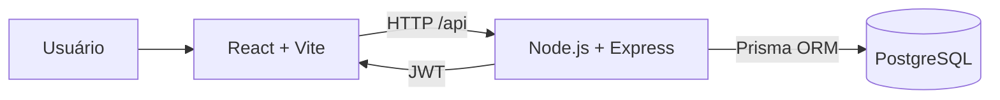

# Finance Dashboard

**Gestão financeira pessoal com dashboard interativo, API REST e autenticação JWT.**

Aplicação full-stack para acompanhar **receitas, despesas e investimentos**, consultar o saldo em diferentes períodos e gerenciar transações em uma interface responsiva. O projeto reúne práticas de desenvolvimento web, integração entre frontend e backend, persistência de dados, testes automatizados e execução com Docker.

**[Código-fonte](https://github.com/adolfo-araujo/dashboard)** · [Documentação da API (ambiente local)](http://localhost:8080/docs)

> **Ambiente de demonstração:** o projeto inclui dados de exemplo para testes locais. Não utilize credenciais de demonstração nem dados financeiros reais em uma implantação pública sem configurar a segurança do ambiente.

## Funcionalidades

- **Conta do usuário:** cadastro, login, logout e renovação de tokens de acesso (access e refresh token).
- **Visão financeira:** saldo do período e totais de ganhos, gastos e investimentos.
- **Gráficos:** distribuição percentual dos lançamentos em gráfico de rosca.
- **Filtros:** este mês, mês passado, últimos três meses, este ano ou intervalo personalizado, preservando o período na URL.
- **Transações:** cadastro, listagem, pesquisa, edição e exclusão, com filtro por tipo.
- **Perfil:** atualização de nome, e-mail e senha, além de exclusão da conta e de suas transações relacionadas.
- **Interface responsiva:** tabela no desktop e lista no celular.

## Tecnologias

| Camada | Tecnologias |
| --- | --- |
| **Frontend** | React 18, Vite, Tailwind CSS, TanStack Query, React Hook Form, Zod, Recharts |
| **Backend** | Node.js, Express, Prisma, Zod, bcrypt |
| **Autenticação** | JWT com access token e refresh token |
| **Banco de dados** | PostgreSQL 16, migrações Prisma e dados de demonstração (seed) |
| **Documentação da API** | Swagger |
| **Infraestrutura** | Docker e Docker Compose |
| **Qualidade** | Jest, smoke test e GitHub Actions |

## Arquitetura



A aplicação está organizada em dois componentes principais:

```text
dashboard/
├── api/                       # API REST, autenticação, Prisma e testes
├── web/                       # Interface React + Vite
├── .github/
│   └── workflows/
│       └── ci.yml             # Integração contínua
├── docker-compose.yml         # Orquestração local
├── push-to-github.sh          # Script auxiliar de publicação
├── push-to-github.ps1         # Script auxiliar para Windows
└── README.md
```

> A árvore acima mostra apenas os principais diretórios e arquivos citados na documentação do projeto.

## Executar com Docker (recomendado)

**Pré-requisito:** Docker Desktop com Docker Compose disponível.

1. Clone o repositório:

   ```bash
   git clone https://github.com/adolfo-araujo/dashboard.git
   cd dashboard
   ```
2. Inicie os serviços:

   ```bash
   docker compose up --build
   ```

Na primeira execução, de acordo com a configuração documentada do projeto, a API aplica as migrações do banco e cria dados de demonstração.

| Serviço | Endereço local |
| --- | --- |
| **Dashboard** | http://localhost:3000 |
| **API** | http://localhost:8080/api |
| **Swagger** | http://localhost:8080/docs |

**Atenção:** as credenciais de demonstração configuradas pelo seed destinam-se exclusivamente ao ambiente local de testes. Consulte a configuração de seed do repositório para conhecê-las ou alterá-las.

Para encerrar os serviços:

```bash
docker compose down
```

Para **apagar também os volumes e dados persistidos** e reiniciar do zero:

```bash
docker compose down -v
```

## Executar em modo de desenvolvimento

**Pré-requisitos:** Node.js, npm, PostgreSQL (ou Docker para o banco) e variáveis de ambiente configuradas.

### 1. Banco de dados

Na raiz do repositório:

```bash
docker compose up -d postgres
```

### 2. Backend — porta 8080

```bash
cd api
cp .env.example .env
npm install
npx prisma migrate deploy
npm run seed
npm run start:dev
```

Edite o arquivo `api/.env` conforme o seu ambiente **antes de executar**. No Windows PowerShell, você pode usar `Copy-Item .env.example .env` no lugar de `cp`.

### 3. Frontend — porta 5173

Em outro terminal, a partir da raiz:

```bash
cd web
npm install
npm run dev
```

Acesse **http://localhost:5173**. O Vite encaminha requisições de `/api` à API local na porta 8080, conforme documentado no projeto.

## API REST

As rotas abaixo foram documentadas na versão atual do projeto:

| Método | Endpoint | Finalidade |
| --- | --- | --- |
| `POST` | `/api/users` | Cadastrar usuário e retornar tokens |
| `POST` | `/api/users/login` | Autenticar usuário |
| `POST` | `/api/users/refresh-token` | Renovar tokens |
| `GET` | `/api/users/me` | Consultar usuário autenticado |
| `PATCH` | `/api/users/me` | Atualizar perfil |
| `DELETE` | `/api/users/me` | Excluir conta |
| `GET` | `/api/users/me/balance?from=YYYY-MM-DD&to=YYYY-MM-DD&today=YYYY-MM-DD` | Consultar saldo e extrato do período |
| `GET` | `/api/transactions/me?from=...&to=...` | Listar transações filtradas |
| `POST` | `/api/transactions/me` | Criar transação |
| `PATCH` | `/api/transactions/me/:id` | Atualizar transação |
| `DELETE` | `/api/transactions/me/:id` | Excluir transação |

Consulte os esquemas e exemplos de requisições na **documentação Swagger** em `http://localhost:8080/docs` quando a API estiver em execução.

## Testes e integração contínua

O repositório documenta um smoke test de ponta a ponta para cadastro, login, operações CRUD, saldo, permissões e renovação de tokens:

```bash
cd api
npm run test:smoke
```

**A API precisa estar em execução** para o smoke test.

Também há testes com Jest no backend (`npm test`, com o ambiente de teste apropriado). O workflow `.github/workflows/ci.yml` usa PostgreSQL, aplica as migrações, executa seed e smoke test e verifica o build do dashboard a cada push.

### Correções de segurança documentadas

Entre os ajustes em relação à API original estão:

- Aguardar corretamente a validação assíncrona de senha com bcrypt.
- Impedir edição de transações pertencentes a outros usuários (`403`).
- Retornar `403` ao tentar excluir transações de terceiros, em vez de erro `500`.
- Não expor hash de senha nas respostas da API.
- Ordenar transações da mais recente para a mais antiga.

Esses pontos são descritos no histórico técnico do projeto; mantenha testes automatizados para evitar regressões.

## Publicação e implantação

A documentação do projeto prevê implantação separada para banco de dados, API e frontend:

- **Banco:** PostgreSQL gerenciado (por exemplo, Neon, Supabase ou Render).
- **API:** serviço Node.js (por exemplo, Render ou Railway) utilizando o `Dockerfile` da pasta `api/`.
- **Frontend:** hospedagem estática compatível com Vite (por exemplo, Vercel ou Netlify) utilizando a pasta `web/`.

Configure no serviço de API as variáveis de ambiente necessárias, incluindo `DATABASE_URL`, `JWT_ACCESS_TOKEN_SECRET`, `JWT_REFRESH_TOKEN_SECRET` e, quando aplicável, `CORS_ORIGIN`. No frontend, configure `VITE_API_URL` com a URL pública de sua API seguida de `/api`, conforme a configuração existente.

> **Não publique** arquivos `.env`, senhas de produção, tokens de acesso ou strings de conexão reais. Não utilize a senha demonstrativa do seed em produção.

## Próximos passos

- [ ] Adicionar capturas reais do dashboard e de suas visualizações em `docs/screenshots/`.
- [ ] Documentar as variáveis obrigatórias do ambiente usando arquivos `.env.example`, sem segredos reais.
- [ ] Verificar acessibilidade e responsividade em diferentes telas.
- [ ] Ampliar cobertura de testes de autenticação, permissões e cálculos financeiros.
- [ ] Adicionar demonstração pública, se houver ambiente seguro com dados fictícios.

## Autor

**João Adolfo Martins Araújo**  
Engenharia de Software — Universidade Veiga de Almeida  
GitHub: [@adolfo-araujo](https://github.com/adolfo-araujo)

---

*Projeto de estudo e portfólio em desenvolvimento full-stack.*
